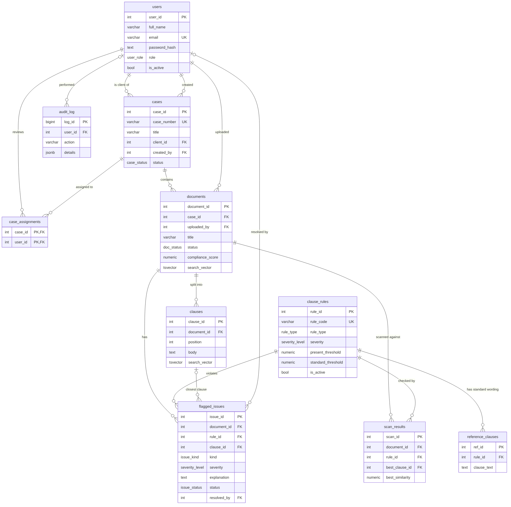

# Legal Document Discovery & Compliance Engine: project documentation

## 1. Problem statement
Junior lawyers and paralegals spend hours checking each contract for the same things (is there a confidentiality clause,
is liability capped, is there a termination notice period). The work is repetitive, error-prone and hard to audit.
Commercial contract-review products exist, but a small legal team has no transparent, self-hosted way to check contracts
against its **own** standard wording.

## 2. Objectives
1. Store cases, contracts and their clauses with full referential integrity and an immutable audit trail.
2. Compare each uploaded contract with a configurable library of standard clauses using **vector similarity** and flag
   missing, non-standard or risky clauses automatically.
3. Compute a per-document compliance score and let reviewers resolve or dismiss each finding.
4. Let users search all contracts by meaning (vector) and by exact words (full-text), and fuse both rankings.
5. Explain every finding in plain English using retrieval-augmented generation (RAG) with a free local LLM.
6. Restrict access by role (Administrator, Reviewer, Client).

## 3. Scope
**In scope:** text-based PDF and .txt contracts; five rules (mutual confidentiality, indemnification with liability cap,
termination with notice, governing law, broad non-compete); three roles; English only.
**Out of scope:** OCR of scanned PDFs, .docx files, legal advice, regulation-specific compliance (GDPR etc.), e-signature,
multi-tenant isolation between law firms, high-availability deployment.

## 4. Functional requirements
| ID | Requirement |
|---|---|
| F1 | Sign in/out; roles admin, reviewer, client; admin manages users |
| F2 | Reviewer/admin creates cases and assigns reviewers; client is attached to the case |
| F3 | Upload PDF/txt: extract text, split into clauses, embed, store, scan against all active rules |
| F4 | Show a report: score, open issues with the closest clause and similarity, per-rule match table, full text |
| F5 | Resolve / dismiss / re-open an issue; score updates automatically |
| F6 | Generate a plain-English explanation of an issue (RAG) |
| F7 | Hybrid search, semantic search, keyword search, "find similar clauses" |
| F8 | Admin manages rules, thresholds and reference clauses; re-apply thresholds to stored scans |
| F9 | Admin views the audit log |

## 5. System architecture
```
Browser (Next.js pages)  ->  Route Handlers /api/*  ->  src/lib (validation, auth, repo)
                                                    ->  PostgreSQL  (relational data, triggers, procedures, views)
                                                    ->  Qdrant      (clause + reference-clause vectors, cosine)
                                                    ->  Ollama      (nomic-embed-text embeddings, llama3.2 generation)
```
**Upload flow** (`src/lib/documents.ts`): extract text -> chunk into clauses -> embed all clauses (Ollama) ->
**BEGIN** -> insert document + clauses -> upsert clause vectors in Qdrant -> for each reference clause run a Qdrant
nearest-neighbour query restricted to this document -> keep the best match per rule -> `CALL sp_record_scan(...)` ->
triggers create flags, score and audit rows -> **COMMIT**. Qdrant cannot take part in a SQL transaction, so on any
failure the SQL part rolls back and the already written points are deleted (compensating action).

## 6. Database choice and justification
| Data | Store | Reason |
|---|---|---|
| Users, roles, cases, assignments, documents, rules, flags, audit log | **PostgreSQL** | Structured, many foreign keys, needs ACID transactions, constraints, triggers and joins. A compliance audit trail cannot tolerate lost updates. |
| Clause text (for display and full-text search) | PostgreSQL | Lives with its document; `tsvector` + GIN index gives ranked keyword search and keeps text and metadata consistent |
| Clause and reference-clause **embeddings** | **Qdrant** (vector database) | "Does this clause mean the same as the standard clause" is a nearest-neighbour search in 768-dimensional space. Relational indexes cannot answer it efficiently; Qdrant is built for it and supports payload filters (`case_id`, `document_id`) |

Why not pgvector? It would also work, but the course asks for two separate paradigms, and keeping vectors outside
PostgreSQL makes the separation (and the compensating-action design) explicit.

## 7. ER diagram


Source: `er-diagram.mmd` (Mermaid). Cardinalities: a user is client of many cases; a case has many documents; a document
has many clauses; a rule has many reference clauses; `case_assignments` resolves the many-to-many between reviewers and cases;
`scan_results` and `flagged_issues` are at most one row per (document, rule).

## 8. Relational schema (3NF)
Primary keys underlined by `PK`, foreign keys by `FK`.

* `users`(**PK** user_id, full_name, email, password_hash, role, is_active, created_at)
* `cases`(**PK** case_id, case_number *unique*, title, description, **FK** client_id -> users, **FK** created_by -> users, status, created_at)
* `case_assignments`(**PK** (**FK** case_id -> cases, **FK** user_id -> users), assigned_at)
* `clause_rules`(**PK** rule_id, rule_code *unique*, title, description, rule_type, severity, present_threshold, standard_threshold, is_active)
* `reference_clauses`(**PK** ref_id, **FK** rule_id -> clause_rules, label, clause_text, created_at)
* `documents`(**PK** document_id, **FK** case_id -> cases, **FK** uploaded_by -> users, title, original_filename, mime_type, file_size_bytes, status, compliance_score, uploaded_at, scanned_at, search_vector)
* `clauses`(**PK** clause_id, **FK** document_id -> documents, position, heading, body, search_vector; *unique* (document_id, position))
* `scan_results`(**PK** scan_id, **FK** document_id, **FK** rule_id, **FK** best_clause_id, **FK** best_ref_id, best_similarity, scanned_at; *unique* (document_id, rule_id))
* `flagged_issues`(**PK** issue_id, **FK** document_id, **FK** rule_id, **FK** clause_id, kind, severity, similarity, explanation, explained_at, status, **FK** resolved_by -> users, resolved_at, created_at; *unique* (document_id, rule_id))
* `audit_log`(**PK** log_id, **FK** user_id -> users, action, entity_type, entity_id, details JSONB, created_at)

Enumerated types (input validation at database level): `user_role`, `case_status`, `severity_level`, `rule_type`, `doc_status`, `issue_kind`, `issue_status`.

## 9. Data dictionary (key columns)
| Table.column | Type | Meaning / constraint |
|---|---|---|
| users.email | varchar(255) | regex CHECK; case-insensitive unique index `lower(email)` |
| users.password_hash | text | bcrypt hash; CHECK length >= 20 so plain text cannot be stored by accident |
| cases.case_number | varchar(30) | generated `CASE-YYYY-NNNN` from a sequence |
| clause_rules.rule_type | enum | `required` = flag if missing/non-standard; `restricted` = flag if present |
| clause_rules.present_threshold | numeric(4,3) | cosine similarity at which a clause counts as "present" |
| clause_rules.standard_threshold | numeric(4,3) | similarity at which present wording counts as "standard"; CHECK >= present_threshold |
| documents.compliance_score | numeric(5,2) | 0..100, maintained by triggers |
| scan_results.best_similarity | numeric(5,4) | best cosine similarity between any clause of the document and any reference clause of the rule |
| flagged_issues.kind | enum | `missing`, `non_standard`, `restricted_present` |
| flagged_issues.explanation | text | RAG output; cleared automatically when the finding changes kind |
| audit_log.details | jsonb | action-specific context |

## 10. Database implementation (SQL)
All DDL is in `db/schema.sql`: `CREATE TYPE/SEQUENCE/TABLE/INDEX/VIEW/FUNCTION/PROCEDURE/TRIGGER`.
`db/alter_demo.sql` demonstrates `ALTER TABLE` (add column, constraints, rename, drop) and `DROP` (index, view, trigger, constraint, column).
DML (INSERT/UPDATE/DELETE/SELECT) is demonstrated in `db/queries.sql` and used throughout `src/lib/repo.ts`.

**Indexes:** unique `lower(email)`; B-tree on every foreign key used in joins; **partial index** `idx_issues_open` on open issues;
**GIN** indexes on both `tsvector` columns.

## 11. Advanced database features (rubric requires four; this project has seven)
| # | Feature | Where | What it does |
|---|---|---|---|
| 1 | **Transactions** | `withTx()` in `src/lib/db.ts`, used by `ingestDocument` | document, clauses, scan results, flags and audit rows commit together or not at all |
| 2 | **Triggers** (8) | `schema.sql` | auto-create/update/remove flags when a scan result is written; stamp resolver; keep score in sync; audit documents and issues; enforce roles (client of a case must be a client, assignees must be reviewers); block UPDATE/DELETE on the audit log |
| 3 | **Stored procedures / functions** | `sp_record_scan`, `sp_reevaluate_all`, `fn_evaluate_scan_result`, `fn_compute_compliance_score` | rule engine and score calculation live in the database |
| 4 | **Views** | `v_document_overview`, `v_case_summary`, `v_rule_stats` | back the dashboard, case list and rule statistics |
| 5 | **Indexing** | see section 10 | unique, B-tree, partial, GIN |
| 6 | **Full-text search** | `clauses.search_vector`, `documents.search_vector` | `websearch_to_tsquery`, `ts_rank`, `ts_headline` |
| 7 | **Vector similarity search** | Qdrant | cosine nearest-neighbour with payload filters |

## 12. Vector database and retrieval strategy
* **What is embedded:** every clause of every uploaded contract, and every reference clause of the rule library.
* **Model:** `nomic-embed-text` via Ollama (768 dimensions; any Ollama embedding model works, the collection size is detected automatically).
  For this model the code adds the `search_document:` / `search_query:` prefixes it was trained with.
* **Storage:** Qdrant collections `document_clauses` (payload: document_id, case_id, clause_id, position) and `reference_clauses`
  (payload: ref_id, rule_id, rule_code); point id = the SQL primary key, so both databases refer to the same rows. Integer payload indexes on filter fields.
* **Metric:** cosine similarity.
* **Compliance check:** for every reference clause, query `document_clauses` filtered to the uploaded document, limit 1; per rule keep the maximum.
  `required` rule: `best < present_threshold` -> *missing*; `< standard_threshold` -> *non-standard*; otherwise compliant.
  `restricted` rule: `best >= present_threshold` -> *risky clause present*.
* **Search:** keyword rank (PostgreSQL) and vector rank (Qdrant, restricted to the user's cases) are fused with Reciprocal Rank Fusion (k = 60).
  Weak vector hits are dropped (`SEARCH_MIN_SCORE`, `SEARCH_WINDOW`).
* **RAG explanation:** retrieve the two reference clauses of the violated rule nearest to the contract's closest clause (Qdrant), put clause +
  standard wording + rule description into the prompt, generate with `llama3.2`, store the text with the issue.

## 13. Important queries
See `db/queries.sql` (JOIN, GROUP BY/HAVING, aggregates, sub-query, correlated sub-query, window function, views, full-text with
ranking and highlighting, STRING_AGG, audit trail, recomputation check). Run with `npm run db:queries`.

## 14. Authentication, authorization, validation, security
Covered in README section 5 and 7. Integrity is enforced in the database (CHECK, UNIQUE, FK, enums, triggers) and again in the API (zod).

## 15. Testing results
| Suite | Command | Result (last run) |
|---|---|---|
| Database: triggers, procedures, views, constraints, cascades, FTS (9 groups) | `npm run db:test` | all passed on PostgreSQL 16 (runs in a throwaway database built from `schema.sql`) |
| End-to-end through HTTP: auth, roles, cross-client isolation, upload (PDF and txt), flags, score trigger, RAG explanation, search modes, admin rules + re-evaluation, audit, cleanup (48 checks) | `npm run e2e` | 48 passed, 0 failed (run twice) |
| Production build and type-check | `npm run build` | passes |

**Important limitation of these results:** they were produced in an environment where Ollama could not be installed, using the
stand-in server `scripts/fake-ollama.mjs` (hashed bag-of-words embeddings and a canned "explanation"). That proves the whole pipeline,
database logic, access control and UI, but it does **not** prove how well `nomic-embed-text` / `llama3.2` separate good from bad clauses.
Run `npm run calibrate`, then `npm run e2e` with real Ollama on your machine and tune the thresholds. A known weak spot of
embedding similarity: a *one-sided* confidentiality clause looks very similar to a *mutual* one, so "mutual vs one-sided" may only
surface as *non-standard* (or not at all). State this honestly in your viva as a limitation and a future enhancement.

## 16. Conclusion and future enhancements
The system shows a clean split of responsibilities: PostgreSQL guarantees integrity, rules and history; Qdrant answers
meaning-based questions; Ollama turns findings into plain English.
Future work: clause-type classifier or cross-encoder re-ranker for better precision; OCR; .docx; side-by-side diff against the standard
clause; per-organisation tenancy; background job queue for long uploads; shared rate limiting.
